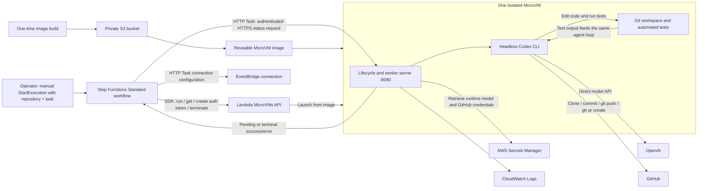

# AWS Lambda MicroVM Software Factory PoC Plan

Status: Proposed; not implemented. Based on [software_factory_poc.md](../../software_factory_poc.md). Read-only checks performed on 2026-10-30 using profile `AWSAdministratorAccess-172318459814`.

Approved direction: simplicity first. One Codex invocation owns the edit–test–fix loop, then commits, pushes, and runs `gh pr create` inside the MicroVM. AWS Step Functions replaces the local launcher, manages the VM lifecycle, and receives terminal success/error status.

**Feasibility:** Documentation and CLI checks support the proposed approach. Live image creation, Codex execution, and end-to-end orchestration remain unverified; Gate 1 establishes runtime feasibility and Gate 2 verifies orchestration.

**Agent:** Run the existing headless Codex CLI inside the MicroVM. Codex owns the edit–test–fix loop and GitHub publication; Step Functions manages VM lifecycle. No Agents API integration or custom reasoning loop is required.

## 1. Minimal PoC Architecture

This is the final architecture. Gate 1 uses manual AWS CLI launch and termination to prove execution; Gate 2 adds Step Functions around the same image and worker.



### Responsibilities

- **Step Functions Standard workflow:** starts from a manual `StartExecution`, launches one MicroVM, waits until it is running, creates one port-scoped auth token, polls status directly through HTTP Tasks, terminates the VM, confirms termination, and ends in `Succeed` or `Fail`.
- **EventBridge connection:** supplies the connection configuration required by HTTP Tasks. Use a non-conflicting API-key header such as `X-Poc-Connection` with a static marker value; the worker ignores it. The actual MicroVM authentication is the dynamic JWE in `X-aws-proxy-auth`, not this marker. Never configure that JWE header in the connection, because connection headers override HTTP Task headers.
- **Reusable image:** contains Python, Git, GitHub CLI (`gh`), a pinned Linux ARM64 Codex CLI, and the selected repository’s toolchain.
- **Headless Codex agent:** modifies source, runs tests, inspects failures, fixes code, and repeats within the same invocation until tests pass, an unrecoverable failure occurs, or the VM is terminated. After passing tests, it commits, pushes the task branch, and runs `gh pr create` inside the MicroVM.
- **Lifecycle/worker server:** initializes one job, starts Codex asynchronously, streams its command/test output to CloudWatch and exposes terminal success/error status; no separate worker deadline is implemented.
- **Secrets Manager:** holds the model API key and GitHub token in one runtime-credentials secret, retrieved only at runtime.
- **CloudWatch:** stores build and runtime logs.
- **GitHub:** supplies the repository and receives a task branch and PR.

**Keep the entire coding and publication workflow inside the MicroVM.** Supply `CODEX_API_KEY` and `GH_TOKEN` to the agent at runtime, configure Git authentication with `gh auth setup-git`, and let it commit, push, and create the PR after passing tests. No Git bundle, temporary local repository, or local publication step is needed.

For the first demonstration, propose a small repository with existing automated tests. The GitHub token needs access to that repository, including contents and pull-request write permissions.

### Command execution and control

Codex executes its shell tools **locally inside the MicroVM**. Step Functions invokes MicroVM lifecycle and token APIs directly through its AWS SDK integration, then calls the worker using `arn:aws:states:::http:invoke`. No polling Lambda, orchestration Lambda, or AWS command-execution API is needed.

One Codex invocation is **not one implementation attempt**: Codex already provides the internal reasoning/tool loop. The worker and workflow do not implement another agent loop or restart Codex after test failures.

The only application route needed is status retrieval. While the worker is active, the workflow waits between polls. Once the task finishes, return exactly one terminal response: `{"ok": true}` after passing tests and creating the PR, or `{"error": "cause"}` for an unrecoverable failure. VM termination can interrupt the worker without a terminal response. A failed test feeds back into the agent loop; it is not immediately a terminal error.

Step Functions uses this response only to select success/error and terminate the VM. Logs remain in CloudWatch; the commit and PR are in GitHub. No logs, diff, commit SHA, PR URL, or token-usage artifacts need to be returned or stored locally. AWS lifecycle hooks start and stop the worker. No general-purpose remote shell endpoint is needed.

Use AWS-managed ingress and internet-egress connectors, with authentication tokens restricted to **port 8080**. HTTP Tasks require one EventBridge connection, even though the JWE header is supplied dynamically. No VPC, NAT Gateway, load balancer, queue, database, webhook, polling Lambda, or locally running controller is required. Definition validation establishes support for this HTTP configuration; a live authenticated request remains a smoke-test requirement.

Sources: [networking](../aws-lambda-microvms/microvms-networking.md), [security](../aws-lambda-microvms/microvms-security.md).

## 2. Implementation Plan

Step Functions orchestration with direct HTTP polling, readiness checks before polling, one auth token per execution, agent-side commit/push/PR creation, the built-in Codex edit–test–fix loop, and terminal success/error reporting are approved. Use only a VM maximum lifespan and an overall workflow timeout as job-level time bounds; do not implement separate worker or polling deadlines. Implementation proceeds through two approved gates: prove execution with a manual AWS CLI launch first, then add orchestration using the same image and worker. Remaining choices below are **proposals for approval**, not implemented configuration.

Implementation verification is limited to a successful end-to-end task, one controlled failure proving error reporting and cleanup, and a separate hard-lifespan check. Observed test-failure repair and exhaustive live fault injection are not required for the initial PoC.

### Gate 1 — Prove execution first

Do not create Step Functions or its EventBridge connection until the real agent task succeeds and the manually launched VM is terminated.

### Step 1 — Fix the demonstration inputs

Before implementation, confirm:

- One repository and pinned base commit.
- One small, objectively testable coding task.
- Existing setup and test commands.
- A model available to the chosen API project.
- Permission for the agent to push a dedicated task branch and create a PR from inside the MicroVM.
- Permission to expose the repository content to the model provider.

Choose a task affecting source/tests, not deployment configuration. Run baseline tests first so pre-existing failures are distinguishable from agent failures.

**Verification:** record the base SHA, baseline test outcome, and expected acceptance test.

### Step 2 — Create only the execution resources

Proposed Gate 1 resources:

1. One private S3 artifact bucket in `eu-central-1`.
2. One image build role.
3. One runtime execution role.
4. One runtime-credentials secret containing the model API key and GitHub token.
5. One CloudWatch log group for image/worker logs.
6. One reusable MicroVM image, built in Step 3.

Permissions below cover both gates; defer orchestration permissions and the Step Functions execution role until Gate 2:

| Principal | Required access |
|---|---|
| Build role | `s3:GetObject` on the image artifact; CloudWatch log creation/writes |
| Execution role | CloudWatch log writes; `secretsmanager:GetSecretValue` on only the runtime-credentials secret |
| Provisioning identity | Resource setup, image creation/inspection/deletion, state-machine and EventBridge connection deployment, and `iam:PassRole` for their specific roles |
| Step Functions execution role | `lambda:RunMicrovm`, `lambda:GetMicrovm`, `lambda:CreateMicrovmAuthToken`, `lambda:TerminateMicrovm`; `iam:PassRole` for the MicroVM execution role; `states:InvokeHTTPEndpoint` for the workflow's GET status requests; `events:RetrieveConnectionCredentials` on the connection; `secretsmanager:GetSecretValue` and `secretsmanager:DescribeSecret` on its managed connection secret |
| Operator using the supplied AWS profile | Gate 1: manual MicroVM launch, inspection, auth-token creation, termination, log reads, and `iam:PassRole` for the runtime execution role. Gate 2: `states:StartExecution`, `states:DescribeExecution`, and execution-history/log reads; retain manual recovery access. |

The build and MicroVM execution roles need the documented Lambda trust policy allowing `sts:AssumeRole` and `sts:TagSession`. In Gate 2, the Step Functions role trusts `states.amazonaws.com`. Add KMS decryption only if using a customer-managed key.

Never copy the administrator profile or its credentials into the image.

**Verification:** inspect build/runtime policies and trust relationships, including scoped access to the artifact, credentials secret, and logs.

### Step 3 — Build a snapshot-safe image

Use the AWS container base `public.ecr.aws/lambda/microvms:al2023-minimal`, which contains the documented snapshot-compatible OpenSSL libraries, and managed MicroVM base image `arn:aws:lambda:eu-central-1:aws:microvm-image:al2023-1`. The installed CLI accepts only `ARM_64`; use compatible agent binaries and repository tooling.

For the small demonstration repository, propose **2 GB / 1 vCPU baseline**, automatically bursting up to **8 GB / 4 vCPU**, with **8 GB maximum disk space**. Disk capacity does not grow with compute bursting; see [images and sizing](../aws-lambda-microvms/microvms-images.md).

Package:

- Pinned agent executable, GitHub CLI (`gh`), Git, and required toolchain.
- Python lifecycle/worker server.
- Empty writable workspace.
- No repository credentials, model keys, task identifiers, or live external connections.

Implement:

| Hook | Proposed behavior |
|---|---|
| `/ready` | Confirm the server is ready; no agent started |
| `/validate` | Check agent executable, workspace writes, and basic process execution |
| `/run` | Validate job configuration, initialize fresh state, spawn the worker, return promptly |
| `/terminate` | Stop the worker/process group and flush available logs |

Repository cloning and model calls happen in the worker, **not synchronously inside `/run`**. The installed CLI limits the run hook timeout to 60 seconds.

After implementing the worker in Step 4, build the image, wait for a successful, active image version, and pin that version for the manual run in Step 5.

**Verification:** build logs show success; snapshot validation performs no credential-dependent operations.

Source: [snapshots](../aws-lambda-microvms/microvms-images-snapshots.md).

### Step 4 — Implement the single-task worker

Implement the planned lifecycle/worker server once; both manual launch and Step Functions invoke its `/run` hook. Do not build a separate feasibility runner.

For each run:

1. Retrieve the model API key and GitHub token at runtime; configure Git authentication with `gh auth setup-git`.
2. Clone the approved repository, check out the pinned base SHA, create a unique task branch, and install declared dependencies.
3. Start Codex once with the submitted task and instructions to modify source, run the approved tests, inspect failures, fix them, and rerun tests until they pass, an unrecoverable failure occurs, or the VM is terminated. Stream JSONL events and stderr to CloudWatch.
4. After passing the final test command with a nonempty change, the same agent creates the Git commit, runs `git push` for the task branch, and runs `gh pr create` against the selected base branch. It must not merge the PR.
5. When Codex exits, return `{"ok": true}` only for a completed workflow with passing tests and confirmed PR creation. Return `{"error": "cause"}` if the agent cannot complete the task or the process fails. A successful process exit alone does not establish task success; VM termination may prevent any terminal response.

Both the manual launch and the workflow supply structured job data in `runHookPayload`, not an interpolated shell command. Run only one VM at a time for this PoC; there is no cross-execution concurrency service.

Start with Codex’s documented `workspace-write` sandbox and enable the outbound network access required for GitHub operations. Verify unattended operation and tool compatibility; do not silently switch to unrestricted execution if it fails.

On publication timeouts, the agent checks whether its branch/PR already exists before retrying to avoid duplicate PRs. Neither the worker nor Step Functions restarts Codex or automatically reruns the entire task. Test-failure repair happens within the existing Codex invocation.

Source: [Codex non-interactive execution](https://learn.chatgpt.com/docs/non-interactive-mode).

**Verification:** exercise the worker through the real task in Step 5; a successful Codex exit alone is insufficient.

### Step 5 — Manually prove the real agent task

Use AWS CLI to launch one VM from the pinned image with the runtime role, managed connectors, and structured `runHookPayload`. Apply the proposed 30-minute maximum lifespan and idle policy from Step 6 as a safety bound.

- Retain the MicroVM ID, wait for `RUNNING`, and create one port-8080 auth token. Request `/status` directly over HTTPS. No Step Functions HTTP Task or EventBridge connection is used yet.
- Confirm the `/run` hook starts the same worker, Codex runs unattended with the intended sandbox, runtime credentials work, and repository setup and model access succeed.
- Confirm meaningful source changes, a recorded passing test command and exit code, and agent-side commit, push, and PR creation. The agent may repair test failures within the same invocation, but the demonstration does not need to encounter one. Check worker output in CloudWatch and the terminal status response.
- Manually terminate the VM on success or failure and use `get-microvm` to confirm `TERMINATED`; retain its ID for recovery if the terminal closes.

**Gate 1 verification:** record the VM ID and outcomes locally; logs remain in CloudWatch and changes in GitHub. Stop here if execution, publication, or termination fails. A generic child-process smoke test does not satisfy this gate.

### Gate 2 — Add orchestration

### Step 6 — Create orchestration resources and define the lifecycle workflow

After Gate 1 passes, create one Step Functions Standard state machine and execution role, and one EventBridge connection. EventBridge automatically stores its connection credentials in a managed Secrets Manager secret. Reuse the proven image and worker without a second execution implementation.

Validate the state-machine definition before deployment, inspect the Gate 2 policies and trust relationship listed in Step 2, and ensure the connection does not define or override `X-aws-proxy-auth` or `X-aws-proxy-port`.

Use a Standard workflow, manually started with the repository, pinned base SHA, and task:

```text
RunMicrovm → Wait/GetMicrovm until RUNNING → CreateAuthToken (once)
                                                   ↓
                                            HTTP PollStatus → Choice
                                                   ↑             │ pending
                                                   └── Wait ─────┘
                          terminal result/error → TerminateMicrovm
                                               → Confirm TERMINATED
                                               → Succeed / Fail
```

- Use `arn:aws:states:::aws-sdk:lambdamicrovms:runMicrovm` to launch from the pinned image version. Set `clientToken` from the execution name and retain the returned MicroVM ID and endpoint in execution state.
- Use `Wait` and `getMicrovm` to check readiness; keep waiting while provisioning, and report unexpected termination as an error. After reaching `RUNNING`, do not call `getMicrovm` on every status poll; reserve further lifecycle checks for failure diagnosis and termination confirmation.
- When the VM is running, call `arn:aws:states:::aws-sdk:lambdamicrovms:createMicrovmAuthToken` once with access to port 8080. Propose a 30-minute expiration, covering status polling within the proposed 28-minute overall workflow timeout, and reuse the token for all status requests. Verify the supported expiration and token reuse in the live smoke test; no token-refresh loop is needed.
- Call `arn:aws:states:::http:invoke` with `Method: GET`, a dynamic URL of `https://<endpoint>/status`, the EventBridge `InvocationConfig.ConnectionArn`, and dynamic `X-aws-proxy-auth` plus `X-aws-proxy-port: 8080` headers. Set a bounded request timeout (propose 10 seconds); HTTP Tasks have a 60-second maximum.
- The worker serves status as JSON. Inspect the HTTP response body for pending or terminal status; an HTTP 200 alone is not task success. On pending, wait (propose 30 seconds), then repeat only the HTTP status request and response check. Preserve only the terminal `{"ok": true}` or `{"error": "cause"}` result for the final outcome.
- The JWE passes through execution state; omit it from final workflow output and application logs, and restrict execution-history access. The EventBridge connection must not overwrite the dynamic authentication header.
- Route catchable post-launch errors to the same cleanup states; preserve the MicroVM ID when catching errors. Invalid or missing terminal responses must not become success.
- Call `terminateMicrovm`, then use `getMicrovm` with `Wait` states until `TERMINATED` is confirmed. Finish in `Succeed` for `ok`, otherwise `Fail` with the cause. Report cleanup failures rather than claiming successful termination.
- A failed launch with no known VM ID ends in `Fail`; a VM launched despite an ambiguous API failure remains bounded by its configured lifespan. Do not restart the agent task.

Retain only a **28-minute overall workflow timeout** and **30-minute MicroVM maximum lifespan** as proposed job-level bounds; no separate worker or polling deadline. Set idle suspension beyond the VM lifespan. The workflow timeout bounds orchestration, while the VM lifespan independently bounds resource use. Their clocks start at workflow execution and VM launch respectively, so these values do not provide a fixed cleanup margin. An overall workflow timeout ends execution as `TIMED_OUT`; it and manual `StopExecution` do not execute `Catch` cleanup or stop the worker. The worker may continue until VM termination, which can interrupt publication and leave no terminal response. The MicroVM lifespan is the fallback; manual termination remains available. Retry a failed `StartExecution` with the same execution name and input rather than starting a new job.

The workflow does not clone repositories, import commits, push branches, create PRs, download artifacts, or run an agent retry loop. Closing the initiating terminal does not stop the AWS-hosted execution.

**Verification:** demonstrate one successful end-to-end task with token reuse across status polls, and one controlled failure that reports an error, terminates the VM, confirms `TERMINATED`, and finishes in `Fail`. Verify the hard VM lifespan separately and cover other negative paths with small worker/workflow tests where practical; see §4. Do not require separate live demonstrations of every failure mode or terminal closure.

Sources: [Step Functions AWS SDK integrations](https://docs.aws.amazon.com/step-functions/latest/dg/supported-services-awssdk.html), [HTTP Tasks and EventBridge connections](https://docs.aws.amazon.com/step-functions/latest/dg/call-https-apis.html).

### Illustrative workflow trigger — not executed

After the state machine, image, roles, and EventBridge connection exist:

```bash
PROFILE=AWSAdministratorAccess-172318459814
REGION=eu-central-1

aws stepfunctions start-execution \
  --profile "$PROFILE" --region "$REGION" \
  --state-machine-arn "$STATE_MACHINE_ARN" \
  --name "$RUN_ID" --input "$JOB_JSON"

aws stepfunctions describe-execution \
  --profile "$PROFILE" --region "$REGION" \
  --execution-arn "$EXECUTION_ARN"
```

`JOB_JSON` contains the repository, pinned base SHA, and task. The state-machine configuration supplies the image version, execution role, connectors, and credentials-secret ARN. Serialize the per-VM job configuration into `runHookPayload`, within its documented 16 KB limit; never pass secret values in execution input.

The Step Functions integration calls `RunMicrovm` with an idle policy of `{"maxIdleDurationSeconds":3600,"suspendedDurationSeconds":0,"autoResumeEnabled":false}` and `maximumDurationInSeconds: 1800`. Use PascalCase parameter names in Amazon States Language (`ImageIdentifier`, `RunHookPayload`, `MaximumDurationInSeconds`, etc.).

Manual recovery, if needed:

```bash
aws lambda-microvms terminate-microvm \
  --profile "$PROFILE" --region "$REGION" \
  --microvm-identifier "$MICROVM_ID"
```

## 3. Risks and Limitations

1. **Actual build/run compatibility remains unproven.** Linux ARM64 binaries, agent sandbox requirements, and repository tooling must pass the smoke test.
2. **Code inside the MicroVM can access or misuse its model and GitHub credentials.** Use a controlled demonstration repository and a token restricted to that repository. This is an accepted PoC trade-off for eliminating local publication machinery, not a design for arbitrary hostile repositories.
3. **Termination destroys workspace state.** Successful work must be committed and published before reporting success. Failed runs retain only the available CloudWatch logs; no local workspace recovery is planned.
4. **Tests are not proof of correctness.** Record actual exit codes, inspect the diff for weakened tests, and require human PR review before merging.
5. **Resource and time limits can interrupt work.** Start with a small repository; increase the image baseline only if measurements justify it.
6. **Documentation and CLI differ.** The installed CLI uses `--resources` with `minimumMemoryInMiB`, not the documentation’s `memory` wording, and accepts only `ARM_64`. Output-skeleton generation also failed on AWS-generated sample fields; it is not evidence of a live API failure.
7. **Stopping Step Functions does not automatically stop the MicroVM.** Catchable errors route to explicit cleanup, but execution aborts and overall workflow timeouts rely on the 30-minute VM lifespan or manual termination.

There is intentionally no load SLO, agent-task recovery, durable task queue, or custom concurrency lock. The operator starts only one execution at a time; Step Functions does not automatically serialize independent executions. Launch latency should be measured; cloning, dependency setup, model calls, and tests will likely dominate total duration.

## 4. Success Criteria

The manual Gate 1 run proves execution feasibility; final PoC success requires Gate 2 with Step Functions. The PoC succeeds when one submitted task:

- Launches exactly one MicroVM from a pinned image version.
- Runs the agent, source edits, shell commands, and tests inside that VM.
- Produces a recorded passing test run with the command and exit code. The agent retains its edit–test–fix loop, but observed repair of a test failure is not a success criterion.
- Creates a commit descended from the submitted base SHA.
- Has the agent run `git push` and `gh pr create` inside the MicroVM, publishing one task branch and GitHub PR without merging.
- Starts from a manual Step Functions `StartExecution` and continues without a running local controller.
- Keeps execution logs in CloudWatch and published changes in GitHub; returns only `{"ok": true}` as the worker's terminal success response.
- Terminates the MicroVM and confirms `TERMINATED`; the workflow finishes in `Succeed` without downloading artifacts.

Additional initial verification:

- **One controlled failure:** propose submitting a nonexistent base commit so repository checkout fails before Codex starts. Confirm the worker returns `{"error": "cause"}`, no PR is published, Step Functions terminates the VM and confirms `TERMINATED`, and the execution finishes in `Fail` with the cause retained.
- **Separate hard-lifespan check:** launch a VM with a short `maximumDurationInSeconds`, idle suspension beyond that lifespan, and a non-publishing setup-failure job. Without explicit termination, confirm the service automatically reaches `TERMINATED`. No agent repair or model call is needed for this check.
- **Small negative-path tests where practical:** cover worker setup/process failures, invalid or missing terminal responses, and workflow HTTP errors and cleanup routing using stubs or simulated responses rather than separate live executions. Verify the configured overall workflow timeout and, where practical, simulate a persistently pending worker to confirm execution becomes `TIMED_OUT` without cleanup or a worker terminal response.

Defer exhaustive live tests of invalid credentials, unresolved test failures, missing/invalid endpoint authentication, connection failures, stopped executions, and terminal closure. Deferring those demonstrations does not remove authentication or failure handling: recoverable tests remain in the agent loop; catchable workflow/HTTP errors route to termination and `Fail`; execution aborts and overall workflow timeouts rely on the configured VM lifespan. A missing or invalid terminal response must never be reported as success.

**Verification performed:** AWS identity, image discovery, quotas, resource listings, pricing queries, CLI help/schema inspection, official documentation review, and `validate-state-machine-definition` for all four lifecycle/auth integration ARNs and token generation followed by direct HTTP polling. The HTTP definition passed with an EventBridge connection and failed without one; output-skeleton generation failed as noted above. No state machine or connection was created, and no live HTTP request was executed.

No application code or AWS resources were changed during planning. End-to-end execution and OpenAI/GitHub access remain untested; implementation requires approval of the remaining proposed choices and demonstration inputs.
