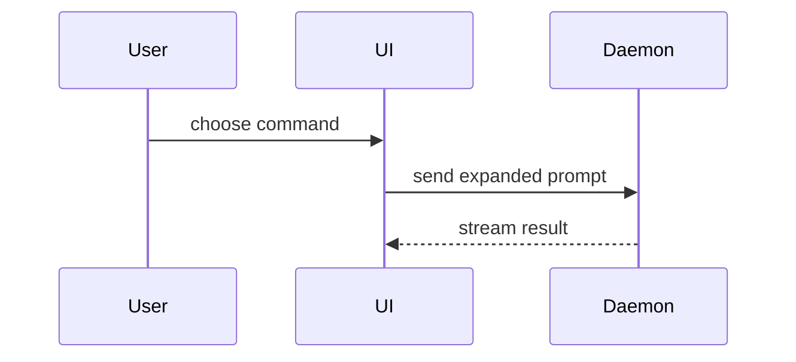

Choose a concise title derived from the supplied Agent task. Use this common PR body template; preserve [attribution](CREDITS.md). Textual sketches and Mermaid source need no browser, diagram renderer, or external skill.

## Worker phase authorization

In a factory Job, follow the worker's current phase authorization:

- **Publication:** commit only the reviewed candidate, push only the assigned task branch, and create one PR against the configured target. Preserve the reviewed source; if further edits are needed, return to implementation and fresh review instead of publishing them under an earlier pass.
- **Merge:** request merge only after the independent worker gate authorizes the exact PR head. Honor all GitHub branch protection and required checks; repositories without required checks remain eligible. Use a merge commit and an exact-head precondition, without administrative bypass, force-push, or direct target-branch push. Confirm actual merge; enabling auto-merge alone is not completion.

Inspect the existing branch and PR after ambiguous publication/merge responses before any further action. Avoid duplicate PRs and unchecked retries. Unresolved outcomes are blocked; no automatic recovery or queue release is authorized. File reading, shell, Git, the installed GitHub CLI, repository-scoped credentials, and network access are required for publication/merge. Missing required capabilities produce a blocked result, not a silent skip.

This skill is not blanket permission to commit, push, or merge in unrelated interactive sessions. Those actions require explicit authorization. Use this template for writing the PR body:

```markdown
## Summary

<diagram, diff-sketch, or tree>

## Evidence

- **Before:** <screenshot/output/failing test run>
  **After:** <screenshot/output/passing test run>

## Review

- **Verdict:** <actual final review verdict>
- **Addressed findings:** <required corrections resolved, or none>

## Merge Danger

**Door:** <one-way or two-way>

<optional: description>

**Blast Radius:** <one-word description>

<optional: potential ramifications of merge>
```

## Sections

Skip all preambles and keep prose brief. Use the user's domain language from `GLOSSARY.md`.

### Summary

Pick the smallest view that makes the key point clear.

- Show logic or an algorithm as pseudocode:

```text
on(save)
  if content is unchanged
    return cached result
  write new content
  return fresh result
```

- Show runtime control flow as a call tree:

```text
submitForm
  createSession
    persistPrompt
    launchAgent
  navigateToSession
```

- Show UI structure as a component tree, including state and module boundaries that matter:

```text
<SessionPage> (apps/example/src/routes/session.tsx)
  useSessionEvents()
  <SessionToolbar>
    <RunSkillButton> (packages/ui)
```

- Show file responsibility or a broad refactor as a shallow file tree:

```text
src/
├── commands/       # parses user actions
├── sessions/       # owns session state
└── transport/      # sends API requests
```

- Show component interaction, control flow, or data flow with Mermaid:



- Use `diff` when the point is what changes and the surrounding shape already exists. Match the diff shape to the topic.

For a component change:

```diff
 <SessionPage>
   useSessionEvents()
   <SessionToolbar>
+    <RunSkillButton />
   <SessionTimeline>
+    <SkillResultCard />
```

For a file-layout change:

```diff
 src/
 ├── commands/
+│   └── show-me.ts       # expands the slash command
 ├── sessions/
-└── transport.ts
+└── transport/
+    ├── client.ts
+    └── stream.ts
```

For a call-tree or call-stack change:

```diff
 submitForm
   createSession
     persistPrompt
+    expandSkillMention
     launchAgent
-  navigateToSession
+  navigateToSession
+    subscribeToEvents
```

For a state or control-flow change:

```diff
 on(save)
-  write content
+  if content is unchanged
+    return cached result
+  write new content
+  invalidate cache
```

- Show the whole block when most of it is new, when omitted context would hide ownership or order, or when the user needs a copyable target shape:

```ts
function expandSkill(command: string): string {
  const skillName = command.slice(1);
  return `use the ${skillName} skill`;
}
```

#### Guidance

Place each visual next to the short text it supports. Keep only the calls, files, props, states, and boundaries needed to answer the user's current question or the options to resolve the current discussion point.

You may use one of these, you may use several, it is unlikely you will use all of them. Use your judgement and don't overwhelm the user.

### Evidence

Concrete evidence that the change works. Show a before and after from actual execution; cite checks run, their results, skipped checks, and material limitations. Never claim verification from intent alone.

Screenshots are S-tier - when the environment is set up for it and the change is visual.

Execution-based evidence is A-tier. Test results, console output. Show the exact test that now fails and passes, using pseudocode.

### Review

Cite the actual final review verdict and required findings addressed. Disclose missing review evidence; do not invent a pass. Worker publication requires its verified passing-review summary.

### Merge Danger

Describe whether it's a one-way or two-way door. You can walk back through two-way doors, but not one-way doors. A PR that is cheap to roll back is lower risk. Changes that involve destructive actions or hard-to-reverse decisions are one-way doors.

The blast radius is the potential impact or scope of the changes introduced by this PR. Consider all possibilities. Examples are layout shift, breakages for consumers, mobile responsiveness, etc.
